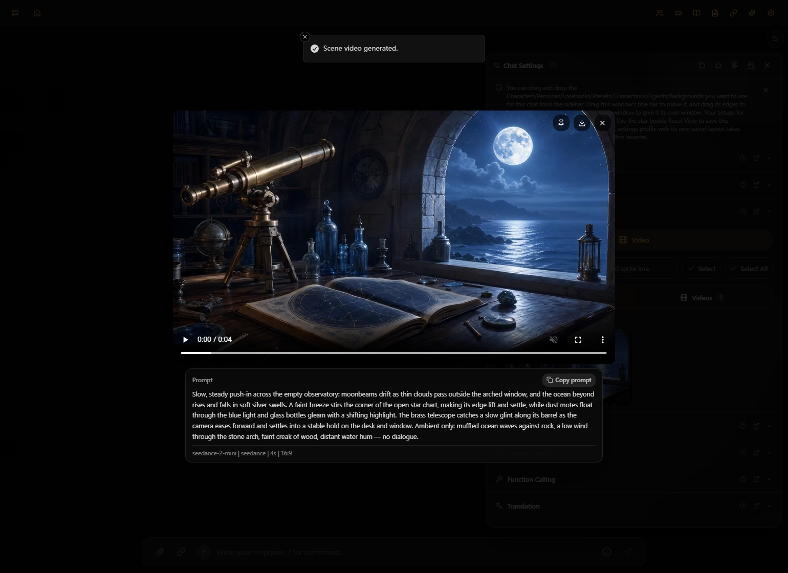

# 在 Marinara 内使用 ToAPIs：已实测的社区适配版

[English](README.md) · [官方快速开始](https://docs.toapis.com/docs/cn/quickstart) · [项目模型与价格入口](https://go2v.toapis.com/1019_mari_g)

**2026-10-21 已完成真实应用链路：Gallery 场景图 → 原生视频提示词预览 → 首帧视频 → 应用内播放、下载、刷新保留。** 基于 Marinara 2.5.1 的固定提交 [`d0e4819`](https://github.com/Pasta-Devs/Marinara-Engine/commit/d0e481913f9a0e3bab0e9b767009500d0577f98a)，需要应用本目录补丁。这是供评估的社区适配版，尚未合并到上游，也未获官方背书。



## 两个站点与 URL，先选对

按 **Marinara 服务端所在网络**选择，而非浏览器语言。官方文档建议中国大陆服务端使用 `.cn`。本次真实应用生成在 `.cn` 完成；同一测试 Key 在两个域名的模型／价格只读请求均成功，但 `.com` 的 Node 连接在本机超时，没有完成应用内真实生成。不能据此承诺所有账户、价格或地区规则完全相同。

| 配置项 | 国内站 | 国际站 |
|---|---|---|
| 网站／账户入口 | https://toapis.cn | https://toapis.com |
| **Marinara / SDK Base URL** | `https://toapis.cn/v1` | `https://toapis.com/v1` |
| **本仓库独立 Python 脚本 TOAPIS_BASE_URL** | `https://toapis.cn` | `https://toapis.com` |
| 图片生成 | `https://toapis.cn/v1/images/generations` | `https://toapis.com/v1/images/generations` |
| 图片查询 | `https://toapis.cn/v1/images/generations/{id}` | `https://toapis.com/v1/images/generations/{id}` |
| 视频生成 | `https://toapis.cn/v1/videos/generations` | `https://toapis.com/v1/videos/generations` |
| 视频查询 | `https://toapis.cn/v1/videos/generations/{id}` | `https://toapis.com/v1/videos/generations/{id}` |
| 参考图上传 | `https://toapis.cn/v1/uploads/images` | `https://toapis.com/v1/uploads/images` |
| 文本／Prompt Model | `https://toapis.cn/v1/chat/completions` | `https://toapis.com/v1/chat/completions` |

Base URL 不填登录页、文档站，也不要拼出 `/v1/v1`。Key 从所选站点控制台获取。参考[官方配置说明](https://docs.toapis.com/docs/cn/quickstart)。补丁不创建项目专属归因，也不自动设置推广账户。

## 安装到独立目录

准备 Git、Python 3.10+、Node **>=24 <27**、**pnpm 10.34.5**。先下载本教程完整仓库，保留 `toapis-models` 目录，因为脚本会复用现有的精确报价模块。依赖可能占数 GB，建议代码、pnpm store、数据和临时文件全部放空间充足的盘；不要覆盖现有安装。

从本教程根目录运行：

```powershell
# 如需安装固定 pnpm：npm install -g pnpm@10.34.5
.\native\Install-CommunityAdapter.ps1 -Target 'D:\Marinara-ToAPIs'
Set-Location 'D:\Marinara-ToAPIs'
$env:DATA_DIR='D:\Marinara-ToAPIs-data'
$env:FILE_STORAGE_DIR='D:\Marinara-ToAPIs-data\storage'
$env:TEMP='D:\Marinara-ToAPIs-temp'; $env:TMP=$env:TEMP
New-Item -ItemType Directory -Force -Path $env:DATA_DIR,$env:FILE_STORAGE_DIR,$env:TEMP | Out-Null
$env:PORT='17863'; $env:HOST='127.0.0.1'
$env:MARINARA_LITE='true'; $env:AUTO_CREATE_DEFAULT_CONNECTION='false'
$env:AUTO_OPEN_BROWSER='false'; $env:UPDATES_APPLY_DISABLED='true'
node packages/server/dist/index.js
```

安装器只接受不存在的绝对路径，拉取固定版本，检查／应用[六文件补丁](toapis-media.patch)，冻结依赖安装并运行 `pnpm check`。不写 Key，不自动付费生成。稀疏检出省略可选的大型美术资源／Illustrator 包，需要时通过应用另行安装。其他系统可手动检出同一提交，`git apply --check`、`git apply`，再 `pnpm install --frozen-lockfile`、`pnpm check`。本教程提供源码和补丁，不是打包好的免安装程序。

## 三类连接分开配

| 用途 | 连接／服务 | 模型 ID | 重点 |
|---|---|---|---|
| 图片生成 | OpenAI image，`openai` | `gpt-image-2` | **普通版**；Quality **Auto**；固定 1k、单张 |
| 视频生成 | Seedance，`seedance` | `seedance-2-mini` | 默认 **4秒 / 480p / 16:9**，无声 |
| 文本／视频提示词模型 | Custom OAI，`custom` | `deepseek-v4-flash` | 单独产生文本费用 |

三条连接都填写所选站点的 `/v1` Base URL 和私有生成 Key。补丁复用界面的 OpenAI / Seedance 类型，仅对 ToAPIs 两个精确域名切换异步任务协议。不能在未打补丁的原版上只换 Base URL。普通模型和 VIP 不可混填。[国内配置 JSON](connections.cn.example.json) · [国际配置 JSON](connections.com.example.json)。

再开一个终端，切回**本教程根目录**：

```powershell
python native/configure.py --site cn
# 先在终端私下设置 TOAPIS_API_KEY，再执行：
python native/configure.py --site cn --apply
```

默认只预览；加 `--apply` 才会在本地应用新建三条连接和独立 Roleplay 演示聊天，绑定图片、视频与文本模型，**不会调用付费生成**，也不会改全局默认供应商。Key 由 Marinara 保存，本地忽略目录 `native/.private/setup.json` 只记录连接／聊天 ID。重复运行复用记录。若本地创建响应丢失，会停止等待核对。

**视频默认参数必须通过 `PUT /api/connections/{id}/default-parameters` 另存，传 JSON 对象。** 固定版本的创建接口会丢弃 `defaultParameters`，不能仅在创建连接时附带它。脚本已处理正确 PUT。手动配置时，在 Roleplay → Chat Settings → Agents / Scene Videos 选择视频连接；聊天文本连接作为视频 Prompt Model。打开提示词发送前预览，确认 **4秒 / 480p** 再点 Generate。图片比例由应用图片／背景尺寸设置控制；本次传入1280×720的比例，实际输出1696×960，不是强制精确像素。

## 先生成图，再在界面动画化

真实图片通过应用 Gallery HTTP 路由生成，使用明确提示词，未经过可选 Illustrator 的 Illustrate 按钮。可以复用：

```powershell
python native/gallery_image.py --prompt 'An empty moonlit coastal observatory, painterly realism, no people, no text' --max-usd 0.02
# 看过当前报价后，明确生成一张付费图片：
python native/gallery_image.py --prompt 'An empty moonlit coastal observatory, painterly realism, no people, no text' --max-usd 0.02 --live
```

脚本检查所选模型／站点与当前 Key 报价，记录提交状态，不自动重发 POST。已存在的 run receipt 会阻止再次生成；更换 `--run-id` 意味着明确请求一张新图。报价环境中的 Key 必须和 Marinara 连接中的一致；报价上限不是服务端强制消费限额。刷新演示聊天，打开 Gallery，点击 **Animate gallery illustration**，核对提示词、时长和分辨率，再生成。文本提示词和视频另行计费。也可以自行上传已有图片后动画化。随后验证播放、Download、刷新后仍保留。

补丁会在 `DATA_DIR/toapis-tasks` 私下记录任务身份后再提交。提交响应丢失时先核对回执和后台用量；不要重复点击 Generate。取消／查询中断不表示上游免费或自动取消。当前没有历史任务自动恢复界面，也没有应用内实时账单面板。不要公开 Key、任务原始响应、签名下载 URL 或私有回执。

## 价格与本次调用费用（2026-10-21）

| 项目 | 当前报价／费率 | 本次真实应用调用 |
|---|---|---|
| `gpt-image-2` 普通 1k，单张 | **$0.015/张**，当前 Key 档位报价 | 1张成功；任务未返回账单，最终实扣未知 |
| `seedance-2-mini` | **$3.285714 / 百万总 tokens** | 请求4秒、480p首帧视频；任务已结算 **$0.13338** |
| 上述视频按实际4.04秒折算 | **本例 $0.033015/秒** | 仅案例折算，不是固定秒价 |
| `deepseek-v4-flash` | 公开默认分组参考：输入 **$0.20/M**，输出 **$0.80/M** | 同模型／时间窗口日志2条，$0.000264 + $0.000444 = **$0.000708**；阶段未知 |

本轮唯一确认的媒体结算合计为 **$0.13338**。不能把图片报价和阶段未知的文本日志相加后称为最终实扣。第一次视频预览发现默认参数错误，在视频提交前停止；因此一个成功视频对应两次文本提示词日志。文本价格来自公开目录，`/v1/pricing` 当前只支持图片／视频，不能当作文本同 Key 精确报价。分组、路由、档位与时段可能影响价格，调用前核对控制台与[官方价格接口说明](https://docs.toapis.com/docs/en/api-reference/account/pricing)。

## 验收结果与边界

| 检查 | 结果 |
|---|---|
| `pnpm check` | 本地化／格式／lint／类型／生产构建通过；一条原有无关 hook 警告 |
| 官方回归运行器 | **22项通过**；模拟媒体 HTTP，零付费 |
| 界面条件回归 | **桌面、移动 Edge 视口共2项通过**；零付费 |
| 真实应用图片路由 | PNG 1696×960，完整解码，90.01秒 |
| 真实界面首帧视频 | 4.04秒，864×496，24fps，97帧，无声，92.585秒 |
| 播放／下载／刷新 | 播放成功；下载 SHA-256 与原文件一致；刷新后1图1视频保留；无页面错误 |

[脱敏实测 JSON](../evidence/marinara-native-2026-10-21.json) · [测试摘要](checks-2026-10-21.md) · [原生提示词预览](../examples/native-2026-10-21/02-native-video-review.png) · [原图](../examples/native-2026-10-21/scene.png) · [原视频](../examples/native-2026-10-21/scene-video.mp4) · [刷新后 Gallery](../examples/native-2026-10-21/04-gallery-after-refresh.png)。

尚未验收：Illustrator 安装及 Illustrate 按钮、原生 UI 参考图编辑、移动 WebKit、其他模型、多用户并发和生产部署。代码允许的其他比例、4–15秒、720p／1080p，并不代表这些组合全部做过付费实测。Test Image / Test Video 路由只做了模拟供应商回包的离线测试。

本目录衍生补丁按 **AGPL-3.0** 分发，见 [LICENSE](LICENSE)。独立多模型脚本与本补丁分开，不能把其模型列表当作应用适配范围。
